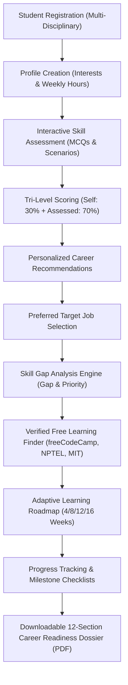

# CareerPath – Your Skills, Your Future
## Comprehensive Presentation Pack & System Demonstration Guide

---

## 1. EXECUTIVE OVERVIEW & PITCH

### 30-Second Elevator Pitch
> *"Over 80% of higher education graduates struggle with career readiness because they don't know what skills employers actually demand, how their abilities measure up, or where to find quality training without paywalls. **CareerPath** is an evidence-based career navigation platform that dynamically adapts to students across **Computer Science, Commerce, Nursing, Medicine, Forensic Science, and Engineering**. We combine objective scenario diagnostics with transparent skill gap mathematics, mapping every single gap directly to verified, 100% free accredited courses and adaptive weekly roadmaps—culminating in an employer-ready Career Readiness Dossier."*

### 2–3 Minute Complete Presentation Script
> *"Good morning respected judges and mentors.
> 
> Higher education today has a fundamental disconnect. Students graduate with formal degrees—be it in BSc Computer Science, BCom, Nursing, or Forensic Science—yet they enter the job market with uncertainty. They ask three urgent questions:
> 1. What careers actually fit my qualification?
> 2. What specific skills am I missing?
> 3. How can I learn these skills without paying expensive course fees?
> 
> Traditional career portals fail them: they present generic job ads, rely on biased self-rating sliders, or sell expensive commercial certifications.
> 
> To solve this real-world crisis, we built **CareerPath � Your Skills, Your Future**.
> 
> Here is how CareerPath transforms the student journey:
> - **Multi-Disciplinary Core:** It is not just another tech tool. Whether you are an MBBS student needing clinical research training or a Nursing student requiring infection control guidelines with statutory council notices, the system dynamically adapts questions, skills, and roadmaps to your discipline.
> - **Evidence-Based Diagnostics:** We replace inflated self-ratings with a transparent tri-level scoring matrix: 30% self-perception and 70% objective scenario-based testing.
> - **Transparent Skill Gap Mathematics:** When a student chooses their target role—say, a Junior Web Developer or Financial Analyst—the system calculates:
>   $$\text{Skill Match \%} = \frac{\sum \min(\text{Current Level}, \text{Required Level})}{\sum \text{Required Level}} \times 100\%$$
>   and immediately flags High, Medium, and Low priority gaps.
> - **Genuinely Free Educational Resources:** We curated and verified direct courses from freeCodeCamp, NPTEL, SWAYAM, MIT OpenCourseWare, Khan Academy, and Microsoft Learn. No hidden fees or false advertising.
> - **Adaptive Roadmaps & Measurable Growth:** Students choose a 4, 8, 12, or 16-week timeline based on their study hours, track weekly milestones with interactive checklists, and download a verifiable 12-section Career Readiness Dossier.
> 
> Built entirely on robust Core PHP 8 and MySQL with responsive UI/UX, CareerPath turns career confusion into structured, measurable career readiness."*

---

## 2. SYSTEM ARCHITECTURE & MODULE WORKFLOW

---

## 3. CORE INNOVATION & DIFFERENTIATORS

| Traditional Platforms | CareerPath Innovation |
|:---|:---|
| **Tech-Biased:** Cater almost exclusively to CS/IT students. | **Multi-Disciplinary:** Natively supports Nursing, MBBS, Commerce, Forensic Science, Engineering, Basic Sciences, and Arts. |
| **Biased Self-Ratings:** Students rate themselves 5 stars with no proof. | **Tri-Level Evaluation:** Combines self-reported rating (30%) with objective diagnostic testing (70%) for honest calibration. |
| **Commercial Paywalls:** Recommend affiliate courses charging thousands of rupees. | **100% Free Educational Finder:** Curates verified courses from freeCodeCamp, SWAYAM, NPTEL, Khan Academy, and MIT OCW. |
| **Generic Timetables:** Static schedules that do not respect student schedules. | **Adaptive Learning Roadmaps:** Generates 4, 8, 12, or 16-week tracks tailored to available study hours per week. |
| **No Tangible Portfolio:** Just a static profile page. | **Verifiable Readiness Dossier:** Instant 12-section printable academic-industry report with verification UUID and signature lines. |
| **Regulated Profession Oversights:** Suggest anyone can be a nurse or doctor. | **Statutory Safeguards:** Explicitly displays council licensing notices (State Nursing Council, NMC) and employment disclaimers. |

---

## 4. FEATURE-BY-FEATURE LIVE DEMO SCRIPT

### Step 1: 1-Click Demonstration Login
1. Open `http://localhost/student-career-finder/auth/login.php` (or `http://localhost/Thecodestrom/auth/login.php`).
2. Point out the **Authentication Portal** on the right side.
3. Click **Rahul Sharma (BSc Computer Science)** to instantly log in as a student targeting *Junior Web Developer*.

### Step 2: Student Dashboard Overview
1. Show the 6 summary cards: **Profile Completion (100%)**, **Assessment Completion (83.3%)**, **Recommended Careers (14)**, **Target Career (Junior Web Developer)**, **Skill Match (82%)**, and **Career Readiness (76.8%)**.
2. Note the **Upcoming Learning Tasks** with interactive checkboxes. Check a task and demonstrate how progress counters increment smoothly.

### Step 3: Interactive Skill Assessment
1. Navigate to **Skill Assessment** in the sidebar.
2. Show **Part 1**: Self-Reported Proficiency Ratings (Level 1 Beginner to Level 4 Advanced).
3. Show **Part 2**: Objective Scenario Challenges tailored to the student's qualification with real code snippets and problem-solving contexts.
4. View the **Assessment Evaluation Report**: Show the **Tri-Level Matrix** comparing Self vs Assessed vs Final Evaluated rating, and the Chart.js horizontal bar graph.

### Step 4: Career Recommendations & Preferred Job Selection
1. Navigate to **Career Recommendations**.
2. Explain the **Match Rationale**: Why each role is recommended based on qualification alignment and percentage overlap.
3. Navigate to **Preferred Job Role**: Demonstrate that students can switch or search any supported career across all disciplines.

### Step 5: Skill Gap Analysis & Mathematical Transparency
1. Navigate to **Skill Gap Analysis**.
2. Show the **Target Career Header**: Junior Web Developer.
3. Highlight the mathematical formula:
   $$\text{Skill Match \%} = \frac{\sum \min(\text{Current Level}, \text{Required Level})}{\sum \text{Required Level}} \times 100\%$$
4. Show the split tables:
   - **Skills Requiring Improvement:** High-priority gaps (e.g. JavaScript ES6 async, PHP backend, MySQL joins) with immediate "Free Courses" action buttons.
   - **Skills Meeting Requirements:** Competencies where student level satisfies target.

### Step 6: Verified Free Learning Finder
1. Click **Free Learning Resources** or the action button on a gap.
2. Demonstrate filters by skill, platform (freeCodeCamp, NPTEL, Microsoft Learn), and status.
3. Show the **Update Progress Modal**: Change a course from *Not Started* to *In Progress* or *Completed* with personal notes.

### Step 7: Adaptive Learning Roadmap
1. Navigate to **Learning Roadmap**.
2. Click **Configure Duration**: Show the modal allowing 4, 8, 12, or 16-week options based on weekly available study hours.
3. Show the weekly milestone breakdown: Learning objectives, topics, free course direct links, and practical mini-projects.
4. Demonstrate task completion checkboxes.

### Step 8: Comprehensive Career Readiness Dossier (PDF Export)
1. Navigate to **My Reports**.
2. Review all **12 official dossier sections**:
   1. Student Profile
   2. Educational Background
   3. Assessment Summary
   4. Existing Evaluated Skills
   5. Preferred Career Role
   6. Statutory Licensing Notices
   7. Skill Gap Analysis
   8. Priority Breakdowns
   9. Recommended Free Resources
   10. Personalized Roadmap Summary
   11. Progress Summary
   12. Career Readiness Composite Score
3. Click **Print / Download PDF**: Show the clean, print-optimized document view with verification UUID and signature line.

### Step 9: Administrator Console
1. Log out and click **1-Click System Administrator Demo Login** (or login with `admin@careerfinder.local` / `Admin@12345`).
2. Show the **Admin Dashboard**: System diagnostics, students count, assessment counts, and activity audit trail.
3. Open **Students Directory**: Search students, inspect active target careers, and toggle account statuses.
4. Open **Career Roles & Skills**: Demonstrate adding a new career or updating required proficiency levels.
5. Open **Assessment Questions**: Demonstrate adding new scenario questions with answer options.
6. Open **Learning Resources**: Demonstrate curating and verifying free educational courses.

---

## 5. LIKELY JUDGE QUESTIONS & EXPERT ANSWERS

### Q1: "How do you ensure your recommendations aren't biased by student self-ratings?"
> **Answer:** *"We implemented a transparent tri-level scoring architecture. While we capture self-reported confidence (weight: 30%), the student must take an objective, discipline-specific diagnostic test featuring technical MCQs and scenario challenges (weight: 70%). The final evaluated rating is calculated as:
> $$\text{Evaluated Rating} = \text{round}(0.30 \times \text{Self} + 0.70 \times \text{Assessed})$$
> This calibrated rating is what drives our skill gap calculations."*

### Q2: "Can non-computer science students realistically benefit from this platform?"
> **Answer:** *"Yes, that is our primary innovation. CareerPath natively supports 15 educational disciplines, including Nursing, MBBS, BCom, Forensic Science, Engineering, and Basic Sciences. For example, an MBBS graduate sees clinical research and medical coding roles; a nursing student sees patient assessment and ICU monitoring with statutory council licensing notices; a commerce student sees financial accounting and GST reconciliation."*

### Q3: "Are the learning resource links actually free, or are they affiliate marketing links?"
> **Answer:** *"Every resource is strictly curated and verified from accredited open-learning providers such as freeCodeCamp, NPTEL, SWAYAM (Government of India), MIT OpenCourseWare, Khan Academy, and Microsoft Learn. We explicitly distinguish between '100% Free' courses and 'Free Course with Optional Paid Certificate', ensuring complete transparency."*

### Q4: "Is this powered by Artificial Intelligence?"
> **Answer:** *"For this platform prototype, we purposefully implemented a robust, deterministic, and explainable rule-based recommendation and gap engine using Core PHP and MySQL. We believe in transparent algorithmic accountability—students and judges can see the exact mathematical formula used to calculate their scores. The architecture is cleanly modularized so that an AI/ML recommendation service can be connected via REST API in future phases without altering the database schema."*

### Q5: "What prevents a student from claiming professional licensure for regulated roles like nursing?"
> **Answer:** *"We built explicit statutory safeguards. For regulated professions (BSc Nursing, MBBS), the platform displays prominent regulatory warning alerts stating that the assessment tests educational competencies only and cannot replace mandatory registration with the State Nursing Council, National Medical Commission (NMC), or statutory competitive examinations."*

---

## 6. EXPECTED SOCIAL IMPACT & FUTURE ENHANCEMENTS

### Social & Economic Impact
- **Democratizing Career Guidance:** Provides tier-2 and tier-3 college students with the same caliber of career diagnostic clarity available at elite universities.
- **Zero Financial Burden:** Emphasizes verified free educational content, eliminating financial hurdles.
- **Employability Enhancement:** Bridges the gap between academic theory and practical industry requirements.

### Future Roadmap
1. **AI-Powered Resume Analysis:** Parsing uploaded CVs to pre-fill existing skills automatically.
2. **Mentorship Connect:** Pairing students who complete 80%+ of their roadmap with verified industry alumni.
3. **Automated Assessment Question Generation:** Leveraging LLMs to generate novel scenario questions from syllabus updates.
4. **Offline PWA Capabilities:** Allowing students in low-connectivity rural areas to access their learning checklists offline.

